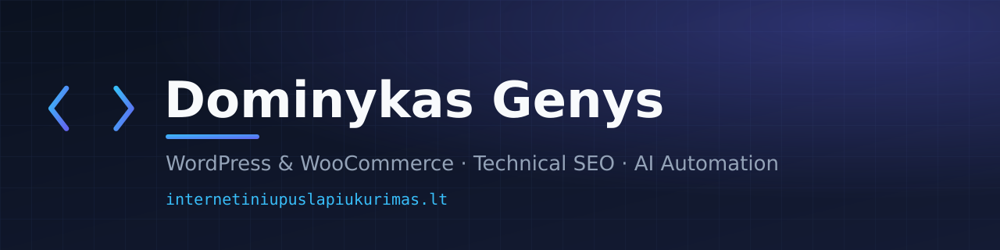

  

  
  

---

### 👋 About

I build **fast, search-optimised websites and online stores** and run the digital side of the business around them: architecture, development, technical SEO, analytics, ads and automation. 6+ years, 30+ projects across e-commerce, automotive, construction, furniture, real estate, tourism and service businesses.

### 🛠️ What I do

| | |
|---|---|
| **WordPress & WooCommerce** | Custom themes and plugins, Elementor Pro, ACF/CPT, Multisite, HPOS, product imports, supplier/XML integrations, YMM compatibility systems, checkout optimisation |
| **Technical SEO** | Core Web Vitals, schema markup, crawl budget, canonicals/redirects, semantic SEO & topical authority, local SEO and Google Business Profiles |
| **Analytics & Ads** | GA4, GTM, Search Console, Google Ads, enhanced e-commerce tracking, Consent Mode v2 |
| **AI & Automation** | AI agents and chatbots (OpenAI / Claude), lead qualification, SEO content pipelines, customer-support automation, MCP-driven site management |
| **Infrastructure** | VPS & cloud hosting, DNS, SSL, email, migrations, backups, security hardening |

### 🧰 Tech stack

### 🌐 Selected projects

- [akumuliatoriuparduotuve.lt](https://akumuliatoriuparduotuve.lt) – battery e-shop, tracking, AI chatbot
- [klinkerland.lt](https://klinkerland.lt) – building materials, SEO-driven
- [elektriniaimoto.lt](https://elektriniaimoto.lt) – electric motorcycles store
- [autopatikrinimas.lt](https://autopatikrinimas.lt) – car inspection, lead generation
- [marabel.lt](https://marabel.lt) – fashion boutique on WooCommerce
- [bookingnida.lt](https://bookingnida.lt) – booking system

### 🎯 Currently

- 🏗️ Building a WordPress Multisite website-rental platform
- 🤖 Developing AI agents and automation for e-commerce
- 📈 Going deeper into advanced technical SEO
- ☕ Expanding into enterprise Java

### 📫 Work with me

Need a site that ranks, converts and scales? → **[internetiniupuslapiukurimas.lt](https://internetiniupuslapiukurimas.lt)**
